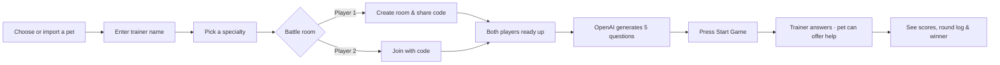
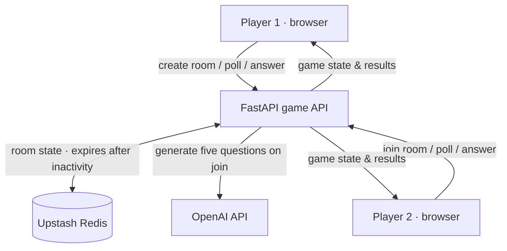

<div align="center">

# 🏛️ CODEXEUM

**Your pet. Your skills. Your move.**

A retro, two-player quiz battle where your pet faces off against a rival in a five-round test of skill.

[](https://react.dev/)
[](https://www.typescriptlang.org/)
[](https://fastapi.tiangolo.com/)
[](https://developers.openai.com/)
[](https://upstash.com/)
[](https://www.docker.com/)
[](https://github.com/ankushop2/Codexeum/commits/main)

**2 players · 5 rounds · 30 seconds per round · 1 winner**

</div>

## What is Codexeum?

Codexeum brings the feel of a retro creature battle to a head-to-head quiz. Pick a companion, choose your specialty, and invite a friend into an arena. Your pets face each other while you answer questions, score points, and see who wins.

OpenAI generates the questions after both players ready up. Trainers choose the answers themselves. For questions outside their pet's specialty, they can ask their pet for help, and the pet also offers a suggestion halfway through the round. Pet responses use the OpenAI API and are not connected to a user's Codex session.

## How to play

For younger learners, question generation targets ages 8–12 with simple vocabulary. The computer opponent always selects the stored correct answer. Successful rounds trigger a pet hop and starburst, respecting reduced-motion preferences. Resolved rounds reveal the correct answer so mistakes become learning opportunities.

The Learning Journey dashboard tracks correct answers and total questions by subject across completed matches under each nickname. It appears in the lobby and after a match. Earlier matches recorded before this feature do not have subject statistics. Accuracy includes assisted answers and counts missed deadlines as questions not answered correctly.



1. **Choose a pet.** Pick a starter or import a Codex pet folder containing `spritesheet.png` (or `spritesheet.webp`) and `pet-record.json`. The importer reads the pet's name and recognizes supported sprite-sheet layouts. You can also select an image and metadata files together.
2. **Pick your specialty.** Choose Geography, Art, Maths, Biology, History, Music, or Science. The two players must choose different specialties.
3. **Create or join a room.** Player 1 shares a six-character code. Both players ready up to generate questions; either player can then press Start Game.
4. **Battle through five questions.** There are two questions from each player's specialty and one from a shared random category. Answer yourself, or get your pet's help on questions outside its specialty. Each round lasts up to 30 seconds and ends early if both players answer.
5. **See who won.** A correct answer earns 5 points on your own or 2 after receiving your pet's suggestion. The round log shows who helped with each scoring answer, plus the final scores and winner or draw.

The arena places your pet opposite your rival, with the question beside it. On small screens the panels stack. Imported pet artwork is shown as a first-frame portrait in battle; a true rear-facing view needs separate artwork.

## What's working—and what's next

| Available now                                  | Planned                         |
| ---------------------------------------------- | ------------------------------- |
| Starter pets and local pet-folder/image import | Richer pet animations           |
| Room codes and two-player matches              | Persistent player profiles      |
| Five AI-generated questions and timed rounds   | More battle modes               |
| Pet answers and trainer guidance               | Improved confidence calibration |
| Scoring, round history, and results            |                                 |
| Nickname leaderboard with pet names            |                                 |

The Pet League leaderboard ranks the top 20 nicknames by total points from completed matches, with wins and games played. It appears in the lobby and after a battle. Bots are excluded. Nicknames are matched without case distinctions, and the latest pet name is displayed. With no sign-up, people using the same nickname share a record. Rankings persist in Redis beyond the room's expiry. Refresh the leaderboard to see recent results.

Room updates use **polling**, rather than a socket connection. The health indicator checks the API process; it does not confirm that Redis or OpenAI credentials are configured.

## How it works

Leaderboard storage uses Upstash Redis: `arena:leaders` is a sorted set of total points, `arena:profiles` stores nickname statistics, and `arena:results` is a Redis Stream containing each completed match's timestamp, scores, pet names and round outcomes. Result logging and ranking updates happen atomically with match completion, preventing duplicate recording from refreshes. These records do not use the room's one-hour expiry. Player tokens and artwork are excluded from the results stream. Configure `UPSTASH_REDIS_REST_URL` and `UPSTASH_REDIS_REST_TOKEN` in the backend deployment for shared rankings.



The backend owns questions, timers, scoring, and answer keys. Player tokens are returned when creating or joining a room and kept in the browser tab's `sessionStorage`. Do not share them. The six-character **room code** is safe to share with your opponent.

Trainer names and selected pet appearances are shared with the room opponent. Imported artwork is cropped to the first sprite-sheet frame and resized to a maximum 128×128 PNG portrait before sending; original files remain on your device. Portraits are stored in the game record, which expires after one hour of inactivity. Leaving locally does not pause or cancel a match.

## Run locally

**Prerequisites:** Node.js 24, pnpm 10.23, uv, Python 3.12, an Upstash Redis database, and an OpenAI API key. Pet selection and the health endpoint work without credentials; creating and joining rooms requires Redis, and preparing questions requires OpenAI.

```sh
pnpm install --frozen-lockfile
uv sync --python 3.12
cp .env.example .env
```

Set these values in your local `.env` (never commit real credentials):

```dotenv
UPSTASH_REDIS_REST_URL=your_upstash_rest_url
UPSTASH_REDIS_REST_TOKEN=your_upstash_rest_token
OPENAI_API_KEY=your_openai_api_key
OPENAI_MODEL=gpt-4o-mini
PET_MODEL=gpt-6-luna
```

```sh
pnpm dev
```

Open [http://localhost:5173](http://localhost:5173). Vite proxies `/api` to FastAPI on port `5001`. The backend loads `.env` automatically. API documentation is available at [http://localhost:5001/docs](http://localhost:5001/docs).

## Docker and deployment

```sh
docker build -t codexeum .
docker run --rm --env-file .env -p 8000:80 codexeum
```

Open [http://localhost:8000](http://localhost:8000). The image builds React and serves the frontend and FastAPI from one container. For Vercel, import this repository with its root as the Root Directory: `vercel.json` selects the Container runtime. Configure the same environment variables in Vercel and make the submission URL publicly accessible. See [Vercel's container deployment guidance](https://vercel.com/kb/guide/does-vercel-support-docker-deployments).

## Game API

| Endpoint                                | Purpose                                                                            |
| --------------------------------------- | ---------------------------------------------------------------------------------- |
| `POST /api/games`                       | Create a room with a specialty and optional trainer/pet profile.                   |
| `POST /api/games/{code}/join`           | Join with a different specialty; wait for both players to ready up.                |
| `GET /api/games/{code}`                 | Get the current state using the player's bearer token.                             |
| `POST /api/games/{code}/answers`        | Submit a zero-based answer index and round number using the player's bearer token. |
| `GET /api/health` and `GET /api/skills` | Check API availability and list the seven specialties.                             |

The frontend polls state approximately once per second. Deadlines and server time are Unix timestamps in seconds; the server decides whether answers are in time. A request advances an expired round. Generated questions can contain errors, so review them when evaluating the demo.

## Credits

Created at the DevDay Community Hackathon in London on 1 November 2026. The React/TypeScript foundation was generated with create-vite; Codex helped build the interface, API integration, and deployment configuration. The starter pets and pixel Colosseum logo are original placeholders. No Pokémon artwork is included. Fonts are served from Google Fonts with system fallbacks; project dependencies retain their respective licenses.

## Bot games and match preparation

Choose Play Against Bot to create a game with an automatically ready bot. The bot answers after two seconds, without extra AI calls. Choose Easy (base 2 correct), Medium (base 3), or Hard (base 4). Each game randomly adds -1, 0 or +1 to that count, producing 1–3, 2–4 or 3–5 correct answers out of five. Correct rounds are chosen once and kept private on the server. Human games require both players to press Ready Up. Once generation completes, Start Game becomes available to either player. Every question lasts 30 seconds, advancing early when both answers arrive.

- `POST /api/games` accepts `"mode":"bot"` (default: `"player"`).
- `POST /api/games/{code}/ready` uses the player bearer token. The second ready player triggers question generation. Failed generation leaves the room waiting; press ready again to retry. Interrupted generation can be retried after 90 seconds.
- `POST /api/games/{code}/start` uses the player bearer token and starts the first round only when questions are ready. Repeated calls during play do not reset the timer.

For bot games, `POST /api/games` accepts `"difficulty":"easy"`, `"med"` or `"hard"` alongside `"mode":"bot"`. The default is `"med"`.

Game setup first asks whether to play with a player or a bot. Player mode offers Create Room or Join Room; bot mode offers Easy, Medium or Hard without revealing answer counts.

Round-end arena effects celebrate correct answers with cheering, stars and jumps; misses and timeouts trigger falling arrows and a wobble. A one-sided hit sends a lightning trail toward the other pet. Effects run once per resolved round for three seconds, without delaying answers. Reduced-motion settings replace movement with static feedback.
